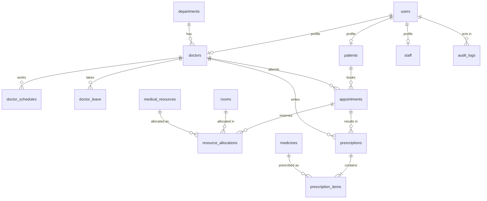

# Riverside Hospital — Appointment & Medical Resource Management

An academic full-stack project: **React + TypeScript + Vite + Tailwind** client, **Node/Express/TypeScript** API, **PostgreSQL** (handwritten parameterized SQL via `pg`), **Zod** validation, **bcrypt** password hashing, **Vitest + Supertest** integration tests on a real PostgreSQL database. Not a certified healthcare system; all data is synthetic.

Four role-based portals: **Patient**, **Doctor**, **Receptionist** and **Administrator** (receptionists and administrators share the `/staff` layout but have different permissions).

## Setup

Requires Node 20+ and PostgreSQL 14+ with the `btree_gist` and `pgcrypto` contrib extensions.

```bash
npm install
cp .env.example .env        # adjust DATABASE_URL / TEST_DATABASE_URL if needed
npm run pg:start            # OPTIONAL: local PostgreSQL on :5433 if you have none (see note below)
npm run db:reset            # DEV ONLY: drop schema, run migrations + views, load sample data
npm run dev:server          # API    http://localhost:4000
npm run dev:client          # UI     http://localhost:5173
```

`npm run pg:start` copies the PostgreSQL binaries bundled with the `embedded-postgres` dev dependency to `C:/pgemb` (avoids Windows path-length limits), initialises a cluster, and creates the `hospital` and `hospital_test` databases (user/password `postgres`, matching `.env.example`). Stop it with `pg_ctl -D C:\pgemb\data stop`.

### Database commands

| Command | What it does |
|---|---|
| `npm run db:migrate` | Applies new files in `database/migrations/` in order (tracked in `schema_migrations`), then re-applies `views.sql`. Non-destructive. |
| `npm run db:seed` | **Safe seeding.** Inserts sample data with `ON CONFLICT DO NOTHING`; never truncates or overwrites; time-dependent demo data (appointments, allocations, prescriptions) is inserted once, guarded by an audit marker. Refuses to run when `NODE_ENV=production` unless `--force` is passed. |
| `npm run db:reset` | Development reset: `DROP SCHEMA public CASCADE`, migrate, seed. Destroys all data. |

### Development accounts (sample data — password for every account: `Password123!`)

| Role | Email | Notes |
|---|---|---|
| Administrator | `admin@hospital.test` | Morgan Ellis |
| Receptionist | `reception@hospital.test` | Riley Brooks |
| Doctor | `asha.rao@hospital.test` | Cardiology; 9 more doctors below |
| Patient | `priya.sharma@example.test` | 9 more patients below |

Doctors (all `@hospital.test`): `asha.rao` (Cardiology), `ben.carter` (Pediatrics), `chitra.nair` (Orthopedics), `dev.malik` (General Medicine), `elena.costa` (Dermatology), `farid.haddad` (Neurology), `grace.liu` (Gynecology), `henry.adeyemi` (Ophthalmology), `isabel.ortega` (ENT), `jonas.weber` (Radiology).
Patients (all `@example.test`): `priya.sharma`, `omar.khan`, `lena.fischer`, `kavya.menon`, `samuel.okafor`, `hana.yoshida`, `mateo.alvarez`, `nora.lindqvist`, `ibrahim.hassan`, `tara.wilson`.

These credentials are for local development only and are intentionally **not** shown in the UI. Passwords are stored as bcrypt hashes. Change `JWT_SECRET` and remove the demo accounts before any real deployment.

### Sample data (what `db:seed` creates)

10 departments · 10 doctors (one per department, linked logins) · 10 patients (linked logins) · 1 receptionist + 1 administrator · weekly schedules (Mon–Fri 09:00–13:00 and 14:00–17:00; Dr. Liu Mon/Wed/Fri; Dr. Nair also Saturday morning) · 3 leave periods · 19 appointments across all five statuses on business days relative to today, all inside each doctor's working hours and with no active overlaps · 10 rooms of 7 types (consultation, procedure, imaging, operating, laboratory, emergency, ward) · 10 medical resources (8 exclusive equipment, 2 shared consumables) · 10 medicines · 5 prescriptions with 8 items · active and released allocations plus an equipment maintenance block · audit records.

## Commands

```bash
npm test            # 56 integration tests on the real test database (re-creates its schema; wipes TEST_DATABASE_URL)
npm run typecheck   # server, client and tests
npm run build       # server (tsc -> server/dist) and client (vite build -> client/dist)
```

## Roles and permissions

| Capability | Patient | Doctor | Receptionist | Admin |
|---|:-:|:-:|:-:|:-:|
| Register / sign in / profile | own | – | – | – |
| Browse doctors, slots; book, cancel, reschedule own appointments | ✔ | – | – | – |
| Book / cancel / reschedule / confirm for any patient | – | – | ✔ | ✔ |
| Complete / no-show; write prescriptions | – | own appointments | – | – |
| Read prescriptions | own | own patients | **no** | ✔ |
| Own weekly schedule and leave | – | ✔ | – | any doctor |
| Register / search / edit patients | – | – | ✔ | ✔ |
| Activate / deactivate patient accounts | – | – | – | ✔ |
| Check availability, allocate rooms / equipment | – | – | ✔ | ✔ |
| Daily schedules and reports | – | own day | ✔ | ✔ |
| Departments, doctors, staff and roles, rooms, equipment, medicines | – | – | – | ✔ |
| Audit logs | – | – | – | ✔ |

Public registration always creates a `PATIENT`; roles can only be changed by an administrator (which also invalidates that user's sessions). An administrator cannot deactivate or demote themselves or the last active administrator.

## Pages

- **Patient:** dashboard (counts, next appointment, history) · step-by-step booking (department → doctor → date & live slots → room/equipment → review → confirm) · my appointments (cancel / reschedule with confirmation, view prescriptions) · profile.
- **Doctor:** dashboard (today, upcoming, completed, no-shows) · appointments (today / upcoming / by date / completed; confirm, complete, no-show, prescribe with multiple medicines, view prescriptions) · weekly hours and leave.
- **Receptionist:** dashboard · patients · appointments (filters, book on behalf of a patient) · daily schedules · rooms & equipment (availability check, allocations) · reports.
- **Administrator:** the above plus **Manage Hospital Data** (tabs: Departments, Doctors, Patients, Appointments, Rooms & resources, Medicines, Staff accounts, Reports & audit) and Audit logs. Tables are searchable and paginated; Add/Edit use modal forms; deactivation uses confirmation dialogs.

## Database

Ordered SQL: `database/migrations/001_schema.sql` (tables and constraints), `002_indexes.sql`, `003_roles_and_management.sql` (receptionist role, `staff`, session version, `is_active` flags), then `database/views.sql` (idempotent: `daily_doctor_schedule`, `department_appointment_counts`). `database/seed.sql` is the repeatable sample data and `database/reports.sql` holds example join / aggregation / subquery / date-filter queries (all executed against the sample database).



| Rule | Mechanism |
|---|---|
| No overlapping active appointments for one doctor | `EXCLUDE USING gist (doctor_id WITH =, tstzrange(start_at, end_at, '[)') WITH &&) WHERE status IN ('BOOKED','CONFIRMED')` (`btree_gist`) — adjacent slots allowed; cancelled / completed / no-show rows do not block |
| No overlapping exclusive room / equipment allocation | two partial exclusion constraints on `resource_allocations` (`status='ACTIVE' AND is_exclusive`) |
| No overlapping working windows per doctor and weekday | exclusion constraint on `doctor_schedules` |
| Valid ranges, statuses, roles, room types | `CHECK` constraints; `cancelled_at` must agree with `status` |
| Unique emails, room numbers, department / resource names, `(medicine, strength)` | `UNIQUE` constraints |
| History is never cascaded away | appointments, prescriptions, allocations reference patients / doctors / rooms with `ON DELETE RESTRICT`; the app deactivates (`is_active`) instead of deleting |
| Credentials separate from profiles | `users` holds email / hash / role; `patients`, `doctors`, `staff` hold profiles (3NF); timestamps are `timestamptz` |

Indexes: patient history `(patient_id, start_at DESC)`, doctor appointments `(doctor_id, start_at)`, status/date filtering `(start_at, status)`, prescription lookup by appointment, allocation lookup by room/resource and time, leave lookup, name search (`lower(full_name)`), audit log. Doctor-schedule lookup by doctor and weekday is served by the unique constraint `(doctor_id, weekday, start_time)` (no redundant extra index).

### Concurrency and transactions

Double-booking protection is enforced by PostgreSQL; the application treats the constraint as the final authority and maps exclusion/unique violations (`23P01`, `23505`) to **HTTP 409** with a safe message (raw database text is never returned). `withTransaction` (`server/src/db/pool.ts`) checks out one `pg` client, runs `BEGIN`, passes that same client to every statement and rolls back on any error. Atomic operations: booking (appointment + allocations + audit), cancellation (status + release allocations + audit), rescheduling (appointment + allocations + audit; a failed move leaves the original booked), prescriptions (header + all items + audit), doctor / patient / staff creation (login + profile + audit), weekly-schedule replacement, leave creation, and resource allocation. State changes lock rows with `SELECT … FOR UPDATE`.

**Availability and slot generation** (`GET /api/doctors/:id/slots`): weekly windows − leave − active appointments − exclusive allocations of any requested room/equipment, in `CLINIC_TZ`, in consultation-length steps, only future slots within `MAX_BOOKING_DAYS`. The booking transaction revalidates working hours, leave, window and the constraints — the displayed list is only a snapshot. Changing a schedule or adding leave that would orphan existing appointments is rejected with 409 and a list of the affected appointments.

**Deactivation rules** (history is always preserved): a department with active doctors, a doctor or patient with upcoming appointments, and a room or equipment item with current/upcoming allocations cannot be deactivated (409). Deactivated people cannot sign in and their sessions are invalidated. Medicines are only ever deactivated; existing prescriptions keep referencing them.

### EXPLAIN ANALYZE

`npx tsx scripts/explain.mts` runs `EXPLAIN (ANALYZE)` on representative queries and writes the real output to `database/explain_output.txt` (first on the seed data, then on ~120k synthetic appointments inserted in a transaction that is rolled back). That file was generated on the earlier, smaller seed and was **not regenerated** after the larger seed; with tiny tables PostgreSQL chooses sequential scans, and with the bulk data the history / doctor-range queries used the new indexes and the overlap probe used the GiST exclusion index. No before/after speed-up claims are made.

## Security

bcrypt password hashing · JWT (8 h) carrying a per-user `token_version`: **logout, role change and deactivation invalidate existing tokens** · server-side role checks on every route (frontend route guards are only UX) · Zod validation on every input · parameterized SQL only · explicit CORS allow-list · rate limiting on login/registration (`AUTH_RATE_LIMIT_MAX` per 15 minutes per IP) · centralized error handler (no stack traces or database messages to clients) · no password hashes or tokens in API responses or logs · the app refuses to start in production without a real `JWT_SECRET`. A least-privilege database role was **not** configured (the app connects as the role in `DATABASE_URL`).

## API (JSON; `Authorization: Bearer <token>`; list endpoints return `{items,total,page,pageSize}` and accept `page`, `pageSize`)

| Area | Endpoints |
|---|---|
| Auth | `POST /api/auth/register` (patients only), `POST /api/auth/login`, `POST /api/auth/logout`, `GET /api/auth/me` |
| Patient profile | `GET/PATCH /api/patients/me` |
| Patients (staff) | `GET /api/patients?search&status`, `POST /api/patients`, `GET/PATCH /api/patients/:id` (activation: admin), `GET /api/patients/:id/appointments` |
| Catalog | `GET /api/departments`, `GET /api/doctors?search&departmentId`, `GET /api/doctors/:id`, `GET /api/doctors/:id/slots?date&roomId&resourceIds`, `GET /api/medicines?search`, `GET /api/rooms`, `GET /api/resources`, `GET /api/availability?startAt&endAt` (staff may add `includeInactive=1`) |
| Appointments | `POST /api/appointments` `{doctorId,startAt,reason?,roomId?,resourceIds?,patientId? (staff)}`, `GET /api/appointments/my` (patient/doctor), `GET /api/appointments?date&from&to&status&doctorId&patientId&departmentId` (staff), `PATCH /api/appointments/:id/cancel · reschedule · confirm · complete · no-show` |
| Prescriptions | `POST/GET /api/appointments/:id/prescriptions` |
| Schedules | `GET/PUT /api/doctors/:id/schedule`, `GET/POST /api/doctors/:id/leave`, `DELETE /api/doctors/:id/leave/:leaveId` (the doctor or an admin) |
| Allocations (staff) | `GET/POST /api/allocations`, `PATCH /api/allocations/:id/release` |
| Admin | `POST/PATCH /api/admin/departments`, `/doctors`, `/rooms`, `/resources`, `/medicines`; `GET/POST/PATCH /api/admin/staff`; `GET /api/admin/audit-logs?action&entityType&from&to` |
| Reports | `GET /api/reports/dashboard`, `/doctor-summary`, `/daily-schedule?date&doctorId`, `/department-counts?from&to`, `/doctor-workload?from&to`, `/patient-history/:patientId`, `/resource-utilization` |

Status codes: `400` validation, `401` unauthenticated / expired / logged-out token, `403` not permitted, `404` missing, `409` booking, resource or integrity conflict, `422` rule violation (outside hours, on leave, past or beyond the booking window), `429` rate limited, `500` unexpected.

## Tests (`tests/`, real PostgreSQL)

`booking.test.ts` (booking, overlap, adjacency, **concurrency with 12 separate `pg` connections and 9 simultaneous HTTP requests**, cancellation and slot reuse) · `transactions.test.ts` (reschedule rollback including a failure after the appointment update, prescription rollback, status transitions, room/equipment conflicts) · `security.test.ts` (registration, login for every role, logout invalidation, rate limiting, patient/doctor/receptionist isolation, schedule/leave conflicts, slot generation, reports) · `management.test.ts` (seed contents, repeatability, availability and overlap integrity of sample data, every sample account signs in, CRUD / search / pagination / filters, duplicate emails, atomic account+profile creation via an injected failure, deactivation rules and preserved history). The schema is rebuilt per file and the data truncated and re-seeded before each test.
